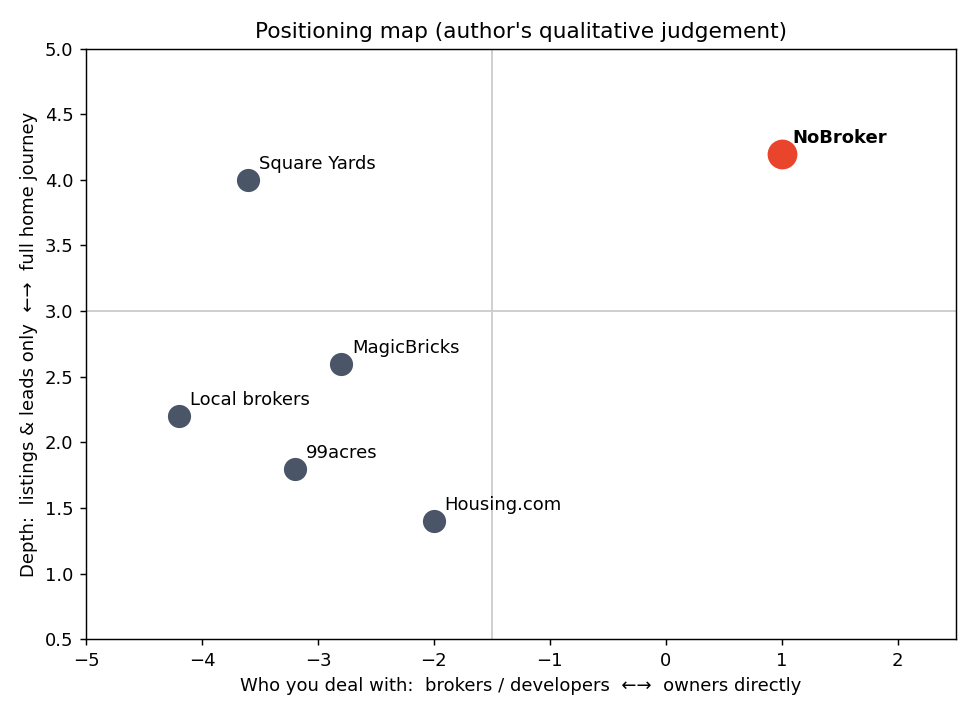

# Competitive benchmarking and positioning: growing NoBroker's inbound leads

**Sources:** public company information, financial filings reported by Entrackr and Inc42, and my own review of
the products. Positioning judgements are mine and qualitative; figures are cited.

## The landscape
| Player | Who lists | Who pays | Main money-maker | Depth beyond listings |
| --- | --- | --- | --- | --- |
| **NoBroker** | Owners directly (no brokers) | Tenants, buyers and owners, via plans | Subscription plans (99% of FY24 operating revenue of INR 803 Cr) | Rental agreements, packers & movers, cleaning, painting, rent pay, home loans, society app |
| **99acres** | Brokers, developers, owners | Brokers and developers (listing packages, ads) | Advertiser packages | Mostly listings and leads; some data and tools |
| **MagicBricks** | Brokers, developers, owners | Brokers and developers | Advertiser packages, some services | Listings plus a growing services layer |
| **Housing.com** | Brokers, developers, owners | Brokers and developers; rent pay users | Advertising, rent pay | Listings, rent pay, some home services |
| **Square Yards** | Developers, brokers | Developers (commission on sales) | Transaction brokerage | Full buying journey: advice, loans, interiors |
| **Local brokers** | Their own network | Tenants/buyers (often 1-2 months' rent) | Brokerage commission | Hand-holding, local knowledge |

**Where NoBroker sits:** the only large player built on **owners dealing directly with tenants and buyers**, and one of
the deepest across the home journey. Its promise is saving the brokerage fee, a clear, emotional benefit.

## Where inbound leads leak
1. **Discovery happens elsewhere.** Search for "2BHK in Kondapur" lands on portals with more listings, because
   broker-fed portals show far more inventory per locality.
2. **Thin supply in premium pockets.** My Hyderabad analysis found premium localities with few listings (e.g.
   Madhapur, Sanath Nagar, Begumpet): a seeker who finds nothing there leaves.
3. **The paywall moment.** Contacting owners needs a paid plan after a few free contacts; that's where serious but
   price-sensitive seekers drop.
4. **Trust doubts.** Seekers worry whether an owner listing is genuine or a broker in disguise.

## Ideas to increase inbound leads (each with a metric)
| Idea | Why it works | Metric to watch |
| --- | --- | --- |
| **Free "what's my home worth" estimate** for owners, using a price model like my Hyderabad one (6% median error) | Brings in owners before they list anywhere; every estimate is a potential listing | Estimates → listings conversion |
| **Locality pages** with real prices, supply and rent trends | Captures search traffic for "rent in [locality]" with useful, unique content | Organic visits and leads per page |
| **Owner acquisition in thin-supply premium areas** (society partnerships via NoBrokerHood, referral rewards) | More inventory where demand outruns supply converts more seekers | Listings per premium locality; seeker contact rate |
| **Verified-owner badge** on listings | Answers the "is this a broker?" doubt that stops contacts | Contacts per listing view |
| **Smarter paywall**: first contact free in thin-supply areas, plan prompt after a reply | Lets serious seekers taste value before paying | Lead-to-paid conversion; refunds |
| **Saved-search WhatsApp alerts** | Brings seekers back when a matching home is listed | Return visits; time to first contact |

**Test, don't assume:** each idea should run as an A/B test or city pilot with a holdout before scaling.
